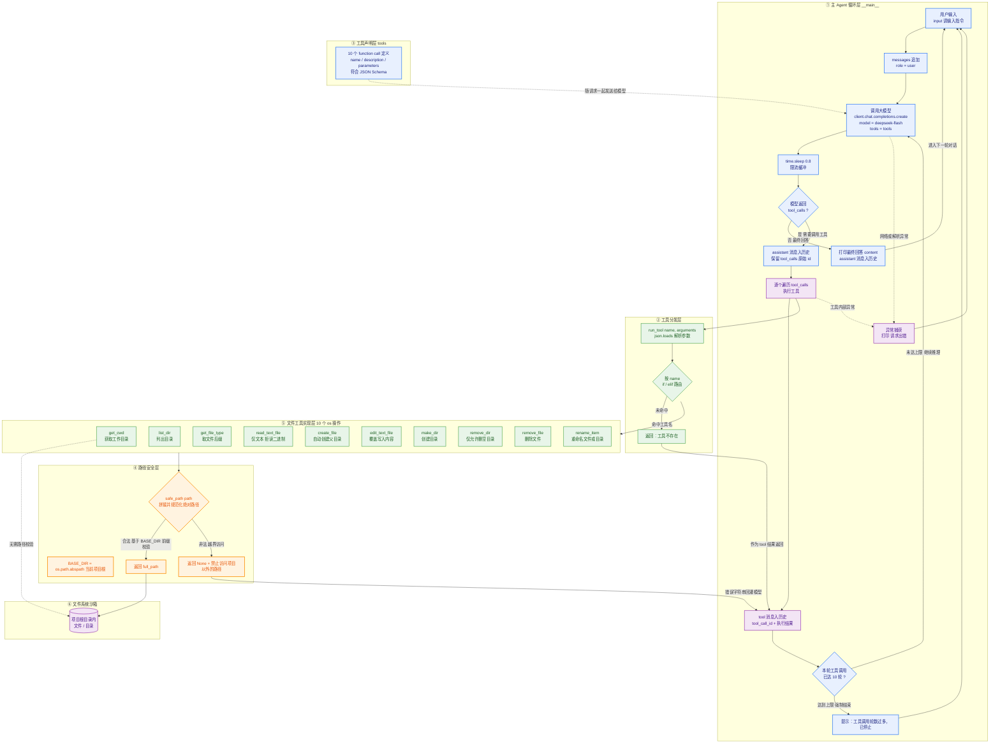

# 文件管理 Agent（chat.py）架构说明

本项目是一个基于 OpenAI SDK（DeepSeek 接口）的 **Function Calling 文件管理 Agent**。
`chat.py` 采用「声明工具 → 模型决策 → 本地分发执行 → 结果回灌」的经典 Agent 循环，
并用 `safe_path()` 做统一的路径越界防护（沙箱限定在项目根目录内）。

## 一、架构流程图

## 二、分层说明

| 层次 | 代码位置 | 职责 |
| --- | --- | --- |
| ① 主 Agent 循环层 | `if __name__ == "__main__":` 之内 | 维护 `messages` 多轮上下文，请求模型，判断 `tool_calls`，把工具结果回灌后再请求模型，最多 10 轮防止死循环 |
| ② 工具分发层 | `run_tool(name, arguments)` | 用 `json.loads` 解析模型给出的参数，按函数名 `if/elif` 路由到具体实现 |
| ③ 工具声明层 | `tools = [...]` | 以 OpenAI function call 格式向模型描述 10 个工具的入参 Schema |
| ④ 路径安全层 | `BASE_DIR` + `safe_path(path)` | 把相对路径拼接成绝对路径，校验是否仍在项目根目录内，越界直接拒绝 |
| ⑤ 工具实现层 | 10 个 `def` 函数 | 真正执行 `os` 层文件/目录操作，并返回字符串结果或错误信息 |
| ⑥ 文件系统沙箱 | 项目根目录 | Agent 可操作的真实文件系统范围 |

## 三、10 个工具清单

| # | 工具名 | 入参 | 关键行为 |
| --- | --- | --- | --- |
| 1 | `get_cwd` | 无 | 返回 `os.getcwd()`，本身不做路径校验 |
| 2 | `list_dir` | `path`（默认 `.`） | 列出目录下所有文件与子目录 |
| 3 | `get_file_type` | `path` | 返回文件后缀名 |
| 4 | `read_text_file` | `path` | UTF-8 读取；`.jpg/.png/.gif/.exe/.zip/.rar` 等二进制直接拒绝 |
| 5 | `create_file` | `path` | 自动 `makedirs` 父目录后创建空文件 |
| 6 | `edit_text_file` | `path, content` | 覆盖写入文本内容（非追加） |
| 7 | `make_dir` | `path` | `makedirs(exist_ok=True)` 创建目录 |
| 8 | `remove_dir` | `path` | 仅删除空目录，非空目录拒绝删除 |
| 9 | `remove_file` | `path` | 删除指定文件 |
| 10 | `rename_item` | `old_path, new_path` | 重命名文件/目录，`try/except` 捕获同名冲突等异常 |

## 四、关键设计要点

1. **协议顺序不可颠倒**：必须先把带 `tool_calls` 的 `assistant` 消息写回 `messages`，再追加 `role = tool` 的响应，
   否则接口会判定 tool 消息没有对应的调用而报错。
2. **双保险的结束条件**：`HAS` 判断模型不再请求工具即输出答案；同时用 `for _ in range(10)` 限制单轮最多 10 次工具往返。
3. **错误也是数据**：所有工具把异常转成字符串返回给模型（如「目录不为空，禁止删除」），
   让 Agent 能自行纠正并继续推理，而不是让程序崩溃。
4. **上下文完整**：最终回答也会 `append` 进 `messages`，保证多轮对话连贯。
5. **限流缓冲**：每次模型请求后 `time.sleep(0.8)`，降低触发 API 频率限制的概率。
6. **安全边界**：`safe_path` 只做前缀校验，属于轻量沙箱；若要更强隔离，可改用 `os.path.commonpath`
   或 `Path.is_relative_to()`，并补充符号链接解析（`os.path.realpath`）校验。

> ⚠️ 安全提示：源码中 `api_key` 为明文硬编码，建议改为读取环境变量或 `config.ini`，并注意不要提交到公开仓库。
