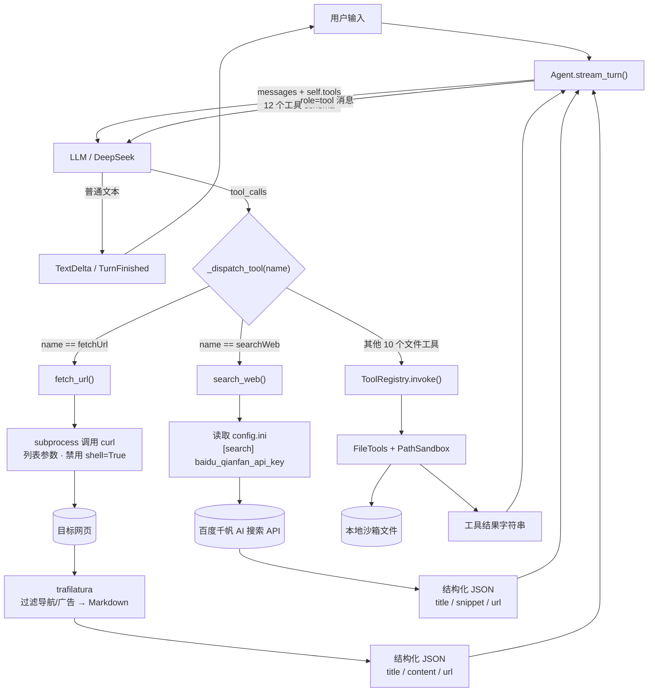
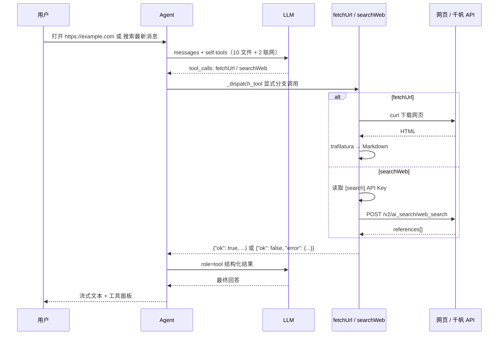

# xAgent — 文件管理 + 联网搜索 Function Call Agent

基于 OpenAI SDK（DeepSeek 接口）与 Textual 的 Function Calling Agent。
在原有 10 个文件工具的基础上，新增两个联网工具：

- **`fetchUrl`**：`subprocess` 调用 `curl` 下载网页，`trafilatura` 提取正文并转 Markdown；
- **`searchWeb`**：调用百度千帆 AI 搜索 API，返回标题、摘要、url 列表。

核心层不依赖任何 UI 库，CLI 与 Textual TUI 复用同一套 Agent 与事件流。

---

## 一、目录结构

```text
Agent/xAgent/
├── config.ini                 # 本地配置（含密钥，已被 .gitignore 忽略）
├── config.example.ini         # 配置模板
├── requirements.txt
├── run_tui.py                 # TUI 启动入口
├── run_cli.py                 # CLI 启动入口
├── core/                      # ============ 核心层 ============
│   ├── __init__.py
│   ├── config.py              # Settings：ini + 环境变量
│   ├── security.py            # PathSandbox：路径安全沙箱
│   ├── events.py              # AgentEvent 事件协议
│   ├── agent.py               # Agent 主循环 + 全局 tools + 工具分发
│   ├── llm/
│   │   ├── __init__.py
│   │   └── client.py          # AsyncOpenAI 封装
│   └── tools/
│       ├── __init__.py        # build_default_registry()（文件工具）
│       ├── registry.py        # ToolSpec / ToolRegistry
│       ├── file_tools.py      # 10 个文件工具实现（未改动）
│       ├── file_schemas.py    # 10 个文件工具声明（未改动）
│       └── web_tools.py       # fetchUrl / searchWeb 实现 + 两个 schema
└── tui/                       # ============ 界面层 ============
    ├── app.py
    ├── styles.tcss
    └── widgets/
```

依赖方向：

```text
tui  ──依赖──▶  core  ──依赖──▶  无界面库
```

`core` 内部不反向依赖 `tui`，也不做 `print` / `input`。

---

## 二、架构

### 2.1 整体流程图



### 2.2 一次联网工具调用的时序



### 2.3 工具注册与分发

`Agent.__init__` 构建全局工具声明列表：

```python
self.registry = registry or build_default_registry(self.sandbox)
self.tools = self.registry.schemas() + WEB_TOOL_SCHEMAS
```

- 10 个文件工具：继续使用 `ToolRegistry`，原有实现与分发逻辑完全不变；
- `fetchUrl` / `searchWeb`：schema 追加到 `self.tools`，调用时由
  `Agent._dispatch_tool()` 的显式 `if/elif` 分支处理：

```python
if name == "fetchUrl":
    output = fetch_url(**parsed)
elif name == "searchWeb":
    output = search_web(**parsed)
else:
    return self.registry.invoke(name, raw_arguments)
```

所有联网工具错误都返回结构化 JSON：

```json
{"ok": false, "error": {"type": "http_error", "message": "服务器返回 HTTP 404：...", "status_code": 404}}
```

模型可以直接读取 `error.type` / `error.message` 并调整方案，不会让 Agent 崩溃。

---

## 三、工具清单

### 3.1 文件工具（原有，未改动）

| # | 工具 | 入参 | 行为 |
| --- | --- | --- | --- |
| 1 | `get_cwd` | — | 返回沙箱根目录绝对路径 |
| 2 | `list_dir` | `path="."` | 列出目录，`[DIR]` / `[FILE]` 标记 |
| 3 | `get_file_type` | `path` | 返回文件后缀 |
| 4 | `read_text_file` | `path` | 仅 UTF-8 文本；拒绝二进制、超 1 MiB 文件 |
| 5 | `create_file` | `path` | 新建空文件并自动建父目录；已存在则拒绝 |
| 6 | `edit_text_file` | `path, content` | 覆盖写入文本 |
| 7 | `make_dir` | `path` | 递归创建目录 |
| 8 | `remove_dir` | `path` | 仅删除空目录，禁止删除沙箱根目录 |
| 9 | `remove_file` | `path` | 删除文件 |
| 10 | `rename_item` | `old_path, new_path` | 重命名文件/目录；不覆盖已存在目标 |

### 3.2 联网工具（新增）

| 工具 | 入参 | 行为 |
| --- | --- | --- |
| `fetchUrl` | `url, timeout=20` | `subprocess` 列表参数调用 `curl` 下载页面（禁止 `shell=True`），`trafilatura` 提取正文转 Markdown，自动过滤导航/广告 |
| `searchWeb` | `query, top_k=10` | 从 `config.ini` 读取 `[search] baidu_qianfan_api_key`，调用百度千帆 AI 搜索，返回标题、摘要、url |

#### fetchUrl 异常分类

| `error.type` | 触发场景 |
| --- | --- |
| `invalid_url` | 非 http/https、缺少主机名 |
| `curl_not_found` | 系统没有 curl |
| `timeout` | curl 超时或 Python 子进程超时 |
| `dns_error` | 域名解析失败 |
| `connect_error` | 无法连接服务器 |
| `http_error` | HTTP 4xx / 5xx（含 404） |
| `empty_response` | 服务器返回空响应 |
| `response_too_large` | 超过 5 MiB 下载上限 |
| `parse_failed` | trafilatura 无法提取正文（脚本渲染、登录页、反爬页等） |
| `missing_dependency` | 未安装 trafilatura |

#### searchWeb 异常分类

| `error.type` | 触发场景 |
| --- | --- |
| `invalid_query` | 搜索关键词为空 |
| `config_missing` | 配置文件 / `[search]` 段 / API Key 缺失 |
| `config_invalid` | 配置文件读取失败 |
| `timeout` | 请求超时 |
| `network_error` | DNS、连接失败或其他网络异常 |
| `api_error` | HTTP 4xx/5xx 或千帆返回业务错误码 |
| `missing_dependency` | 未安装 requests |

#### 成功返回示例

`fetchUrl`：

```json
{
  "ok": true,
  "url": "https://example.com",
  "title": "Example Domain",
  "content": "This domain is for use in documentation examples...",
  "content_chars": 156,
  "truncated": false
}
```

`searchWeb`：

```json
{
  "ok": true,
  "query": "百度千帆 AI 搜索",
  "count": 2,
  "results": [
    {"title": "标题 A", "snippet": "摘要 A", "url": "https://a.example"},
    {"title": "标题 B", "snippet": "摘要 B", "url": "https://b.example"}
  ]
}
```

---

## 四、安全与稳定性

- URL 仅允许 `http` / `https`；curl 额外使用 `--proto` / `--proto-redir` 限制协议；
- curl 使用列表参数和 `--` 终止选项，禁止 `shell=True`，URL 不会被解释成命令行参数；
- `--connect-timeout` + `--max-time` + Python `subprocess` 超时三重兜底；
- 下载上限 5 MiB，正文回灌上限 2 万字符（`truncated=true`）；
- API Key 只从 `config.ini` 的 `[search]` 读取，源码中没有任何密钥；
- 文件工具继续使用 `PathSandbox`：`resolve()` + `is_relative_to()`，阻止路径越界；
- 工具异常统一收敛为字符串，Agent 主循环不会因工具失败而崩溃。

---

## 五、安装与配置

### 5.1 安装依赖

```bash
cd Agent/xAgent
python -m venv .venv

# Windows CMD / PowerShell
.venv\Scripts\activate

# Git Bash
source .venv/Scripts/activate

pip install -r requirements.txt
```

`fetchUrl` 依赖系统 `curl`。Windows 10/11 已内置：

```bash
curl --version
```

### 5.2 config.ini

```ini
[llm]
base_url = https://api.deepseek.com/v1
model_name = deepseek-flash
api_key = sk-xxxx
stream = true
temperature = 0.0

[agent]
max_tool_rounds = 10
request_interval = 0.8
workspace = workspace

[search]
# 百度千帆 AI 搜索 API Key：只放这里，禁止写进源码
baidu_qianfan_api_key = your-baidu-qianfan-api-key
# 千帆 AI 搜索接口地址
endpoint = https://qianfan.baidubce.com/v2/ai_search/web_search
# 单次搜索超时（秒）
timeout = 15
# 默认返回条数（1-20）
top_k = 10
```

`baidu_qianfan_api_key` 留空或仍是占位符时，`searchWeb` 返回 `config_missing`
结构化错误，不影响 Agent 启动和其他工具使用。

`config.ini` 已被仓库根目录的 `.gitignore` 忽略；可复制 `config.example.ini` 作为模板。

---

## 六、运行

### 6.1 TUI

```bash
python run_tui.py
# 或
python -m tui
```

- `Enter` 发送，`Esc` 中止当前请求；
- `Ctrl+L` 清空对话，`Ctrl+C` 退出；
- 内置命令：`/help` `/clear` `/reset` `/tools` `/status` `/quit`。

### 6.2 CLI

```bash
python run_cli.py
```

示例对话：

```text
你 > 搜索 2026 年诺贝尔物理学奖，取前 5 条
你 > 打开上一条结果里的第一个链接，总结正文
你 > 把总结保存到 notes/physics.md
你 > 列出 notes 目录
```

最后两条验证原有文件管理功能没有被破坏。

---

## 七、测试

### 7.1 单函数测试

```bash
# fetchUrl 成功
python -X utf8 -c "from core.tools.web_tools import fetch_url; print(fetch_url('https://example.com'))"

# fetchUrl 404（结构化错误）
python -X utf8 -c "from core.tools.web_tools import fetch_url; from core.tools.registry import ToolError
try: print(fetch_url('https://example.com/not-found-page'))
except ToolError as e: print(e)"

# fetchUrl 超时 / DNS / 非 HTML
python -X utf8 -c "from core.tools.web_tools import fetch_url; from core.tools.registry import ToolError
try: print(fetch_url('http://10.255.255.1', 1))
except ToolError as e: print(e)"
python -X utf8 -c "from core.tools.web_tools import fetch_url; from core.tools.registry import ToolError
try: print(fetch_url('https://no-such-host.invalid'))
except ToolError as e: print(e)"
python -X utf8 -c "from core.tools.web_tools import fetch_url; from core.tools.registry import ToolError
try: print(fetch_url('https://api.github.com/repos/python/cpython'))
except ToolError as e: print(e)"

# searchWeb：未填 Key 时应返回 config_missing
python -X utf8 -c "from core.tools.web_tools import search_web; from core.tools.registry import ToolError
try: print(search_web('测试'))
except ToolError as e: print(e)"

# searchWeb：填写真实 Key 后
python -X utf8 -c "from core.tools.web_tools import search_web; print(search_web('百度千帆 AI 搜索', 5))"
```

### 7.2 工具注入与分发测试

```bash
python -X utf8 -c "
from core.agent import Agent
a = Agent()
print('tools:', len(a.tools))                       # 12
print('web:', [t['function']['name'] for t in a.tools][-2:])
print(a._dispatch_tool('fetchUrl', '{\"url\": \"https://example.com\"}').ok)
print(a._dispatch_tool('list_dir', '{\"path\": \".\"}').ok)
"
```

### 7.3 端到端 Agent 对话测试

```bash
python run_cli.py
```

依次输入：

```text
搜索 2026 年诺贝尔物理学奖，取前 5 条
打开 https://example.com 并总结正文
新建 docs/test.md，写入 hello
读取 docs/test.md
删除 docs/test.md
```

预期：

- `searchWeb` 返回标题 / 摘要 / url；
- `fetchUrl` 返回 Markdown 正文；
- 文件工具仍然正常创建、读取、删除；
- 所有工具调用都以 `[调用]` / `[OK]` 或 `[FAIL]` 展示。

---

## 八、扩展新工具

- 文件工具：在 `file_tools.py` 加方法、`file_schemas.py` 加声明，注册表自动分发；
- 联网工具：在 `web_tools.py` 加 schema 和函数，再追加到 `WEB_TOOL_SCHEMAS`，
  并在 `Agent._dispatch_tool()` 增加一个显式分支。

---

## 九、依赖清单

```txt
openai>=1.40.0
textual>=0.80.0
requests>=2.31.0
trafilatura>=1.12.0
```

系统依赖：

- `curl`（Windows 10/11 自带，Linux/macOS 通常已安装）。

> ⚠️ `config.ini` 中的密钥仅用于本地运行，请勿提交到公开仓库。
