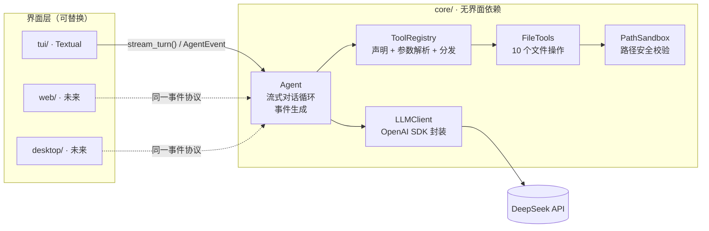

# xAgent — 文件管理 Function Call Agent

基于 OpenAI SDK（DeepSeek 接口）与 Textual 的文件管理 Agent，在原
`Practice02/chat.py` 的基础上完成 **核心层 / 界面层分离** 重构。

- `core/`：工具定义、function call 调度、10 个文件工具、路径安全校验、大模型对话循环。
  不 import 任何 UI 库，不包含 `print` / `input`，可独立运行。
- `tui/`：基于 Textual 的终端界面，只负责渲染、接收输入、展示事件，不含业务与工具逻辑。

---

## 一、目录结构

```
Agent/xAgent/
├── config.ini                 # 本地配置（含密钥，已被 .gitignore 忽略）
├── config.example.ini         # 配置模板
├── requirements.txt
├── run_tui.py                 # TUI 启动入口
├── run_cli.py                 # CLI 启动入口（证明 core 可独立运行）
├── core/                      # ============ 核心层 ============
│   ├── __init__.py            # 对外公开接口
│   ├── config.py              # Settings：ini + 环境变量
│   ├── security.py            # PathSandbox：路径安全沙箱
│   ├── events.py              # AgentEvent 事件协议（界面层唯一依赖）
│   ├── agent.py               # Agent 主循环：流式对话 + function call
│   ├── llm/
│   │   ├── __init__.py
│   │   └── client.py          # AsyncOpenAI 封装（流式/非流式归一化）
│   └── tools/
│       ├── __init__.py        # build_default_registry()
│       ├── registry.py        # ToolSpec / ToolRegistry / 参数解析与分发
│       ├── file_tools.py      # 10 个文件工具实现
│       └── file_schemas.py    # 10 个工具的 function-calling 声明
└── tui/                       # ============ 界面层 ============
    ├── __init__.py
    ├── __main__.py            # python -m tui
    ├── app.py                 # Textual App：布局、事件消费、命令、快捷键
    ├── styles.tcss            # 界面样式
    └── widgets/
        ├── __init__.py
        ├── chat_view.py       # 滚动区与消息挂载
        ├── messages.py        # 用户/助手/系统/错误/工具调用控件
        └── status_bar.py      # 底部状态栏
```

依赖方向严格单向：

```
tui  ──依赖──▶  core
core ──依赖──▶  无界面库
```

`core` 内部也不反向依赖 `tui`；`tui` 只 import `core` 的 `Agent`、`Settings` 和事件类。

---

## 二、架构



### 关键设计

1. **事件驱动的解耦接口**：`Agent.stream_turn(text)` 返回 `AsyncIterator[AgentEvent]`。
   界面层不认识工具、沙箱和 OpenAI 协议，只消费事件：

   | 事件 | 含义 | 界面层典型处理 |
   | --- | --- | --- |
   | `RoundStarted(round)` | 开始新一轮推理 | 更新状态栏 |
   | `TextDelta(text)` | 流式文本片段 | 追加到助手气泡 |
   | `ToolCallStarted(call_id, name, arguments, raw_arguments)` | 即将执行工具 | 展示工具面板 |
   | `ToolCallFinished(call_id, name, ok, output, elapsed)` | 工具执行结束 | 更新面板状态与结果 |
   | `ErrorEvent(message)` | 可展示的错误 | 错误提示 |
   | `TurnFinished(final_text, rounds, tool_calls, interrupted)` | 本轮结束 | 收尾、恢复输入 |

   所有事件都带 `to_dict()`，Web 端可直接序列化成 JSON 帧。

2. **工具注册表**：新增工具只需 `registry.register(...)`，Agent 主循环无需改动；
   工具异常统一收敛为 `ToolExecution(ok=False)`，以字符串回灌模型，程序不会崩溃。

3. **协议顺序**：严格保证「带 `tool_calls` 的 assistant 消息 → 对应 role=tool 消息」
   的先后顺序，满足 OpenAI / DeepSeek 的 function calling 校验。

4. **取消与回滚**：用户按 `Esc` 中止或发生异常时，`Agent` 回滚到本轮开始前的上下文，
   不会留下半截 `tool_calls` 导致下一轮请求非法。

5. **流式输出 + 节流渲染**：模型逐 token 流式返回；界面按 80ms 合并刷新 Markdown，
   避免频繁重排。

---

## 三、10 个文件工具

| # | 工具 | 入参 | 行为 |
| --- | --- | --- | --- |
| 1 | `get_cwd` | — | 返回沙箱根目录绝对路径 |
| 2 | `list_dir` | `path="."` | 列出目录，`[DIR]` / `[FILE]` 标记 |
| 3 | `get_file_type` | `path` | 返回文件后缀 |
| 4 | `read_text_file` | `path` | 仅 UTF-8 文本；拒绝二进制、超 1 MiB 文件 |
| 5 | `create_file` | `path` | 新建空文件并自动建父目录；已存在则拒绝 |
| 6 | `edit_text_file` | `path, content` | 覆盖写入文本 |
| 7 | `make_dir` | `path` | 递归创建目录 |
| 8 | `remove_dir` | `path` | 仅删除空目录，禁止删除沙箱根目录 |
| 9 | `remove_file` | `path` | 删除文件 |
| 10 | `rename_item` | `old_path, new_path` | 重命名文件/目录；不覆盖已存在目标 |

### 安全边界

- 使用 `Path.resolve()` + `is_relative_to()` 校验，符号链接展开后再判断，修复了原先
  `startswith(BASE_DIR)` 的前缀匹配漏洞（`xAgentEvil/` 可绕过）。
- 删除 / 重命名不允许作用于沙箱根目录本身。
- `create_file` 不再静默截断已有文件；`rename_item` 不覆盖目标。
- 所有越界与非法参数都转成错误字符串返回给模型，由模型自行纠正。

---

## 四、运行说明

### 1. 安装依赖

```bash
cd Agent/xAgent

python -m venv .venv

# Windows CMD / PowerShell
.venv\Scripts\activate

# Git Bash
source .venv/Scripts/activate

pip install -r requirements.txt
```

### 2. 配置

复制模板并填入 API Key（`config.ini` 已被仓库根目录的 `.gitignore` 忽略）：

```bash
cp config.example.ini config.ini
```

```ini
[llm]
base_url = https://api.deepseek.com/v1
model_name = deepseek-flash
api_key = sk-xxxx
stream = true
temperature = 0.0

[agent]
max_tool_rounds = 10
request_interval = 0.8
workspace = workspace
```

也可以不写密钥，改用环境变量（优先级更高）：

```bash
export XAGENT_API_KEY=sk-xxxx
# 可选：XAGENT_BASE_URL / XAGENT_MODEL / XAGENT_WORKSPACE
```

`workspace` 是文件沙箱，启动时自动创建；相对路径以 `config.ini` 所在目录为基准。

### 3. 启动 TUI

```bash
python run_tui.py
# 或
python -m tui
```

界面说明：

- 输入自然语言指令，`Enter` 发送；
- `Esc` 中止当前请求（上下文自动回滚）；
- `Ctrl+L` 清空对话与上下文，`Ctrl+C` 退出；
- 工具调用以可折叠面板展示参数、结果与耗时。

内置命令：`/help` `/clear` `/reset` `/tools` `/status` `/quit`。

示例指令：

```
列出当前目录
新建 docs/notes.md，写入「今天的学习笔记」
把 docs/notes.md 重命名为 docs/day1.md
读取 docs/day1.md
删除 docs 目录
```

### 4. 启动 CLI（不依赖 Textual）

```bash
python run_cli.py
```

这是验证 `core` 可独立运行的最小入口：只用 `input()` / `print()` 消费同一套事件流。

---

## 五、扩展新界面（Web / Desktop）

界面层只需要实现三件事：**收集输入 → 消费事件流 → 渲染**。

### Web（FastAPI WebSocket 示意）

```python
from fastapi import FastAPI, WebSocket
from core.agent import Agent

app = FastAPI()

@app.websocket("/ws")
async def ws(sock: WebSocket):
    await sock.accept()
    agent = Agent()
    try:
        while True:
            text = await sock.receive_text()
            async for event in agent.stream_turn(text):
                await sock.send_json(event.to_dict())   # 事件自带 to_dict()
    finally:
        await agent.aclose()
```

### Desktop（PySide / Tkinter 等）

在后台线程或 asyncio 事件循环里运行：

```python
async for event in agent.stream_turn(text):
    queue.put(event)   # 用线程安全队列把事件交给 GUI 主线程渲染
```

只要新界面消费的是 `core.events` 里的事件，就不需要改动 `core` 的任何代码。
TUI 的 `tui/app.py::_handle_event` 就是一份完整的事件消费参考实现。

### 新增工具

1. 在 `core/tools/file_tools.py` 添加方法；
2. 在 `core/tools/file_schemas.py` 的 `FILE_TOOL_DEFINITIONS` 添加声明；
3. 或在启动时向 `ToolRegistry` 注册自定义工具：

```python
registry.register(
    name="echo",
    description="原样返回输入",
    parameters={"type": "object", "properties": {"text": {"type": "string"}}, "required": ["text"]},
    handler=lambda text: text,
)
agent = Agent(registry=registry)
```

---

## 六、与原 `chat.py` 的差异

| 项 | 原实现 | 重构后 |
| --- | --- | --- |
| 界面与业务 | 混在一个文件 | `core/` 与 `tui/` 完全分离 |
| 配置 | 密钥硬编码在源码 | `config.ini` + 环境变量 |
| 输出 | 非流式，一次性 `print` | 流式事件，TUI 增量渲染 |
| 工具分发 | `if/elif` 长链 | 注册表 + 声明驱动 |
| 错误处理 | `print` 到终端 | 结构化 `ErrorEvent` |
| 取消/异常 | 上下文可能残缺 | 自动回滚到本轮之前 |
| 路径安全 | `startswith` 前缀校验 | `resolve()` + `is_relative_to()` |
| 可复用性 | 仅终端 | 任意界面/服务复用同一 `Agent` |

> ⚠️ `config.ini` 中的密钥仅用于本地运行，请勿提交到公开仓库。
